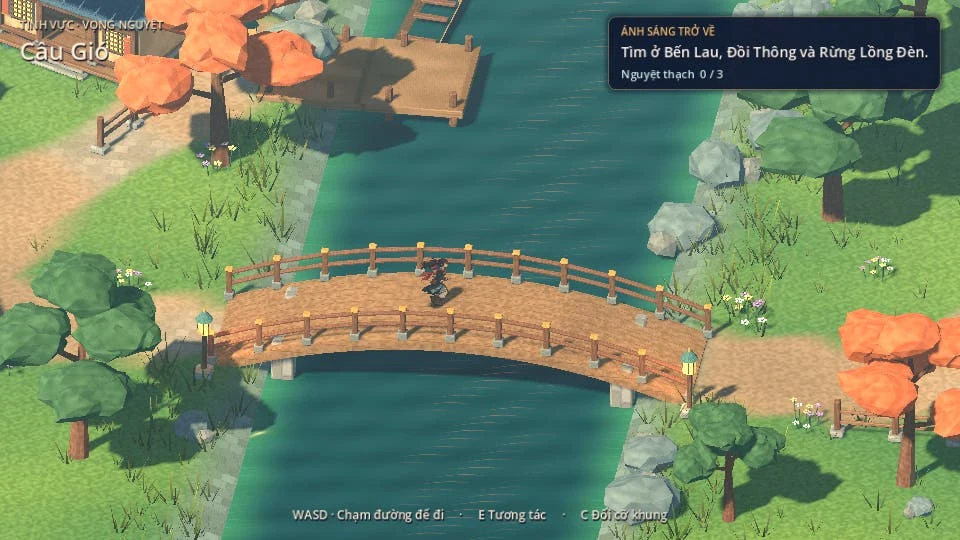

# Tinh Vực · Vọng Nguyệt

**Lát cắt Fantasy** là cảnh mặc định trong mã nguồn hiện tại. Mở Godot 4.3 và bấm F5 để nhận hợp đồng ở Hội quán La Bàn Gãy, qua cổng Thành Vách Gió và đánh Thạch Vệ tại Rừng Lam Diệp. [Hướng dẫn Phase 3 và ảnh A/B](docs/phase-3.md)

## Bờ Sông Nguyệt 0.3

**Bờ Sông Nguyệt 0.3** là chương phiêu lưu HD-2D trong Godot. Lữ khách dùng sprite anime 2D và bước qua địa hình 3D ở góc máy 3/4. Từ Xóm Bến Sương, bạn có thể rẽ xuống Bến Lau, sang sông bằng Cầu Gió, tìm lên Đồi Thông và đi qua cổng Rừng Lồng Đèn để tới Miếu Trăng Nổi.

## Chơi thử

Tải APK cho Android hoặc bản Godot đóng gói cho Windows 64-bit. Trên Windows, giải nén và giữ tệp PCK cạnh tệp EXE. [Bản 0.3 và video gameplay](https://github.com/lightingfff/Tu-v-ng-nguy-t-/releases/tag/v0.3.0)

- Dùng **WASD**, phím mũi tên hoặc bấm/chạm vào mặt đất để đi. **C** đổi giữa hai cỡ khung.
- Bấm **E** hoặc nút tương tác khi ở gần người giữ đền. Tìm ba mảnh nguyệt thạch ở **Bến Lau**, **Đồi Thông** và **Rừng Lồng Đèn**, rồi quay đến miếu.

## Xem và chỉnh map trong Godot

Mở [godot/project.godot](godot/project.godot) bằng Godot 4.3, chọn [cảnh Sông Nguyệt](godot/world/song_nguyet_3d.tscn) rồi bấm **F6**. Cảnh này chứa camera, môi trường, nguồn nắng và nhân vật. [Cảnh thung lũng](godot/world/valley.tscn) chứa hai bờ, lòng sông và vị trí của từng model. Khu vực có thể đi rộng khoảng **110 × 63 m**.

- [Models](godot/world/models) có 13 tệp glTF riêng cho nhà trà, miếu, cầu, cổng, bến, thuyền, đèn, hai loài cây, đá, thùng hàng, hoa và hàng rào. Lưới địa hình và núi là hai tài nguyên mesh riêng.
- [Textures](godot/world/textures) chứa texture theo bề mặt. Model có UV và các khe vật liệu cho gỗ, ngói, đá, đồng, tường đất và tán lá. Bạn có thể nhập từng glTF vào Blender hoặc đặt từng model trong Godot.
- [Materials](godot/world/materials) gồm shader chuyển lớp giữa đất, cỏ và đá, shader dòng nước và shader cỏ lay. Nắng tạo bóng bằng hình khối 3D. Đèn lồng và ánh đèn gần miếu có nguồn sáng cục bộ. Sương phụ thuộc khoảng cách nhìn.

Cầu, nhà, gốc cây, cột cổng và hàng rào có va chạm. Mặt cầu đưa lữ khách lên và xuống theo độ dốc. Lan can và tán cây có thể che sprite khi nhân vật đi ra sau chúng.

## Tham khảo HD-2D

Ở gameplay Dragon Quest III HD-2D, bậc đá và lan can tạo cao độ, tán cây gần máy tạo che khuất, và ánh sáng giúp đọc lối đi. Octopath Traveler II dùng camera có bố cục định hướng và nguồn sáng tương phản để phân biệt khu vực khám phá. Bờ Sông Nguyệt áp dụng các nguyên lý này vào kiến trúc và hành trình riêng. [Gameplay Dragon Quest III](https://store.steampowered.com/app/2701660/DRAGON_QUEST_III_HD2D_Remake/) · [Gameplay Octopath Traveler II](https://store.steampowered.com/app/1971650/OCTOPATH_TRAVELER_II/) · [Phỏng vấn đội Octopath Traveler II](https://www.unrealengine.com/developer-interviews/octopath-traveler-ii-builds-a-bigger-bolder-world-in-its-stunning-hd-2d-style)

## Web 0.2

Bản Web dùng bản đồ cuộn ngang 2D của phiên bản 0.2. Chạy `npm ci` và `npm start` bằng Node.js 20 trở lên để mở chế độ Web nhiều người chơi ở http://localhost:3000. Chạy `npm run build:offline` để tạo bản HTML một tệp. [Tải Web 0.2](https://github.com/lightingfff/Tu-v-ng-nguy-t-/releases/tag/v0.2.0)
