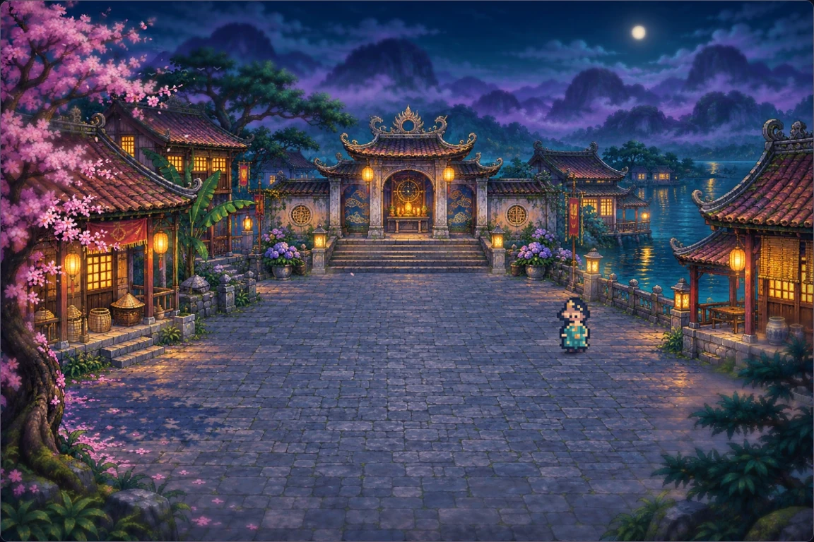
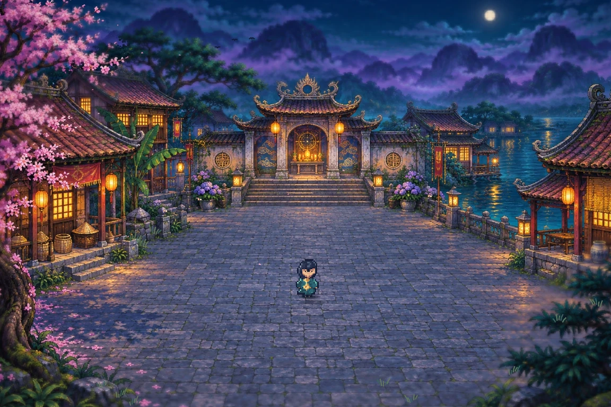

# Tinh Vực · Vọng Nguyệt

Cảnh thử đồ họa HD-2D của một dự án MMORPG lấy cảm hứng từ làng ven hồ Việt Nam. Làng Hạ Nguyệt có đền đá và mái ngói dưới ánh trăng, với đèn hổ phách phản chiếu trên hồ. Một lữ khách pixel art đứng trong quảng trường để bạn so độ rõ của nhân vật với tiền cảnh và hậu cảnh.

## Mở hai bản dựng

| Bản dựng | Cách mở |
| --- | --- |
| Web | Cài Node.js 20 trở lên, chạy `npm ci` rồi `npm start` ở thư mục gốc. Mở [chế độ xem cảnh](http://localhost:3000/?view=scene). |
| Godot | Mở [godot/project.godot](godot/project.godot) bằng Godot 4.3 trở lên và bấm **F5**. |

Mở [bản chơi thử web](http://localhost:3000/) để di chuyển bằng **WASD**, phím mũi tên hoặc chạm vào quảng trường. Đến gần Người giữ đền rồi bấm **E**, nhặt ba mảnh nguyệt thạch và mang lên Ấn Nguyệt. Mở thêm một tab để thấy lữ khách thứ hai. Máy chủ đồng bộ nhân vật và xử lý tiến độ theo phiên, tối đa 24 kết nối.

Trong Godot, dùng **1–3** để xem toàn cảnh, bậc đền và mặt hồ. **Space** dừng chuyển động, **H** ẩn chữ, **D** bật hoặc tắt độ sâu trường ảnh và **L** bật hoặc tắt sương và ánh sáng. **F11** chuyển toàn màn hình.

## So sánh cảnh Hạ Nguyệt

| Web | Godot |
| --- | --- |
|  |  |

## Hướng đồ họa

Cảnh dùng nền nguyên bản của Hạ Nguyệt và hai lớp mặt nạ cho tiêu cự và vùng nước. Bản Web dùng Canvas 2D, còn bản Godot dùng Camera2D và shader CanvasItem trên renderer Compatibility. Cả hai mô phỏng tia sáng và gợn phản chiếu dựa trên vị trí của đèn và mặt hồ trong tranh. Bảng màu xanh tím của trăng đẩy núi và hồ ra xa, trong khi ánh đèn ấm giữ mắt ở đền và lối đi. Cỏ, cành cây, cánh hoa và sinh vật nhỏ chuyển động ở các nhịp khác nhau để giữ không khí yên tĩnh của làng về đêm.

- Dải nét quanh nhân vật và cách phối sprite với môi trường có ánh sáng theo độ sâu. [Phỏng vấn nhóm Octopath Traveler II](https://www.unrealengine.com/developer-interviews/octopath-traveler-ii-builds-a-bigger-bolder-world-in-its-stunning-hd-2d-style)
- Ánh sáng tương phản làm rõ từng lớp trong khung hình, đặc biệt ở dưới nguồn sáng và trên bề mặt phản chiếu. [Odd Tales về The Last Night](https://oddtales.net/blog/2017-the-last-night-reveal-trailer-at-e3-2017)
- Cây và kiến trúc làm khung, với các khoảng mở dẫn mắt đến nhân vật và cảnh xa. [Hình ảnh của Hillfort Games cho Long Gone](https://www.longgonegame.com/)
- Thử nghiệm phối tia sáng, DOF và phản xạ với đồ họa pixel trên web. [Video Bilibili](https://www.bilibili.com/video/BV1dhn36VEF8/) · [Dự án tham chiếu](https://github.com/holooooo/the-last-night-tribute)

Dùng `npm run check` để kiểm tra cú pháp Web. Biến môi trường `PORT` thay cổng máy chủ mặc định.

## Kiểm tra bản dựng

- Web đã được kiểm tra trên Chromium ở khung desktop và điện thoại. Hai phiên chơi đồng bộ vị trí, giữ tiến độ nhiệm vụ riêng và cập nhật khi một người rời phòng. Chế độ ngắm cảnh mở trực tiếp không chiếm suất trong phòng chơi.
- Godot 4.3 đã chạy bằng renderer Compatibility trên Linux. Đã kiểm tra ba góc máy, dừng chuyển động và so hình trước/sau khi bật độ sâu trường ảnh và ánh sáng. Nhân vật đứng yên để tập trung đánh giá chiều sâu, ánh sáng và chuyển động của môi trường.
