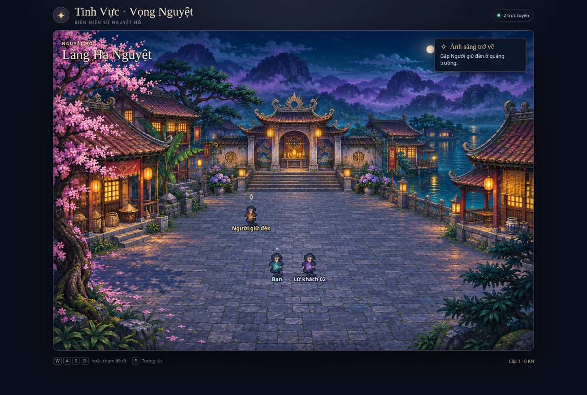

# Tinh Vực · Vọng Nguyệt

**Tinh Vực · Vọng Nguyệt** là nguyên mẫu MMORPG HD-2D chơi trên trình duyệt, lấy cảm hứng từ kiến trúc làng ven hồ Việt Nam. Khi ánh trăng suy yếu, những lữ khách tới làng Hạ Nguyệt để tìm các mảnh nguyệt thạch và thắp lại Ấn Nguyệt.



## Chơi thử

Cần Node.js 20 trở lên.

```sh
npm ci
npm start
```

Mở http://localhost:3000. Mở thêm tab hoặc trình duyệt để gặp một lữ khách khác. Mỗi máy chủ hỗ trợ tối đa 24 phiên kết nối cùng lúc.

- Di chuyển bằng **WASD**, phím mũi tên hoặc bấm/chạm vào quảng trường.
- Đến gần Người giữ đền rồi bấm **E** hoặc nút **Nói chuyện**.
- Bước tới ba mảnh nguyệt thạch, sau đó lên bậc đền và tương tác với Ấn Nguyệt.

## Bản chơi thử 0.1

- Một cảnh nguyên bản ở góc nhìn 3/4 với nền pixel, chuyển sắc ánh trăng, hạt sáng và đèn lồng nhấp nháy.
- Nhân vật Canvas có bóng chân, hoạt ảnh bước đi, và thứ tự hiển thị dựa trên vị trí chân.
- Máy chủ Node.js xử lý va chạm, di chuyển và tiến độ nhiệm vụ. WebSocket đồng bộ nhân vật giữa các trình duyệt.
- Tiến độ được giữ theo phiên kết nối. Phiên mới bắt đầu lại từ đầu.
- Phạm vi mở rộng dự kiến gồm lưu nhân vật, chiến đấu, nhiều bản đồ và thử tải với nhiều phòng.

Dùng `npm run check` để kiểm tra cú pháp. Có thể đổi cổng bằng biến môi trường `PORT`.
