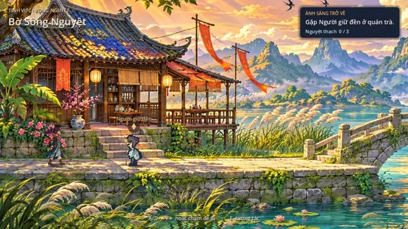

# Tinh Vực · Vọng Nguyệt

**Chương I · Bờ Sông Nguyệt** là bản chơi thử của dự án RPG phiêu lưu 2.5D. Từ quán trà dưới tán cây, bạn đi về phía đông qua cầu đá và đem ba mảnh nguyệt thạch tới ngôi miếu treo chuông trăng. Camera đi cùng nhân vật trên bản đồ ngang 2560 × 853.

## Tải và chơi

| Nền tảng | Cách mở |
| --- | --- |
| Android | Tải [APK](https://github.com/lightingfff/Tu-v-ng-nguy-t-/releases/download/v0.2.0/Song-Nguyet-Android.apk), cài trên điện thoại Android và chơi ở chiều ngang. |
| Windows 64-bit | Giải nén [bản Godot cho Windows](https://github.com/lightingfff/Tu-v-ng-nguy-t-/releases/download/v0.2.0/Song-Nguyet-Windows-x64.zip), giữ tệp PCK cạnh `Song-Nguyet.exe` và mở EXE. |
| Trình duyệt | Tải [bản Web một tệp](https://github.com/lightingfff/Tu-v-ng-nguy-t-/releases/download/v0.2.0/Song-Nguyet-Web.html) rồi mở tệp HTML bằng trình duyệt trên máy tính. Tất cả hình ảnh và mã chạy đều nằm trong tệp. |

Bấm **A/D**, dùng phím mũi tên trái phải hoặc chạm vào đường để di chuyển. Đến gần người ở quán trà rồi bấm **E** hoặc nút tương tác để nhận nhiệm vụ. Các bản tải về chơi một người, tiến độ được giữ trong lần chơi hiện tại.

## Đồ họa và chuyển động

- Sáu khung hình chạy thể hiện các nhịp tiếp đất, co gối và đẩy chân. Bóng đổ dùng dáng nhân vật ở đúng khung hình đó. Khi đứng yên, lữ khách thở nhẹ.
- Cụm lau tiền cảnh trượt nhanh hơn mặt cầu. Núi xa dịch chuyển chậm hơn khi camera bám theo người chơi. Các lớp lau có trục xoay ở gốc để ngọn cây nghiêng theo gió.
- Texture vật liệu mã hóa hướng gồ ghề trên bề mặt đá và mặt nạ nước. Shader dùng hai dữ liệu này để tái tạo ánh xiên trên đá, dải bóng mát dưới tán và vệt phản quang dao động trên sông. Godot dùng shader CanvasItem. Web dùng WebGL khi trình duyệt hỗ trợ và Canvas 2D cho đường vẽ dự phòng.

Phong cách nhân vật lấy cảm hứng từ kỹ thuật giữ hình khối dễ đọc khi tô bóng anime của Arc System Works. Hướng đèn ấm, bóng chân và cách ghép nhân vật với môi trường tham khảo chia sẻ của đội ngũ Octopath Traveler. Các tranh, nhân vật và sprite trong bản dựng được tạo riêng cho Sông Nguyệt. [Bài trình bày của Junya Motomura tại GDC](https://www.ggxrd.com/Motomura_Junya_GuiltyGearXrd.pdf) · [Phỏng vấn trên Unreal Engine](https://www.unrealengine.com/spotlights/octopath-traveler-s-hd-2d-art-style-and-story-make-for-a-jrpg-dream-come-true)

## Chạy từ mã nguồn

**Web nhiều người chơi.** Dùng Node.js 20 trở lên, chạy `npm ci` rồi `npm start`. Mở http://localhost:3000 trên máy chạy server. Các máy cùng mạng có thể dùng địa chỉ IP và cổng của máy đó. Máy chủ Node/WebSocket đồng bộ chuyển động cho tối đa 24 phiên và xử lý nhiệm vụ riêng của từng người chơi. Chạy `npm run build:offline` để tạo `dist/Song-Nguyet-Web.html`.

**Godot.** Mở [godot/project.godot](godot/project.godot) bằng Godot 4.3 và bấm **F5**. Các cấu hình xuất Android, Windows và Linux nằm trong [export_presets.cfg](godot/export_presets.cfg). Để tự xuất bản, cài export templates trùng phiên bản Godot. Với Android, cấu hình SDK và khóa ký của bạn trong Godot.
