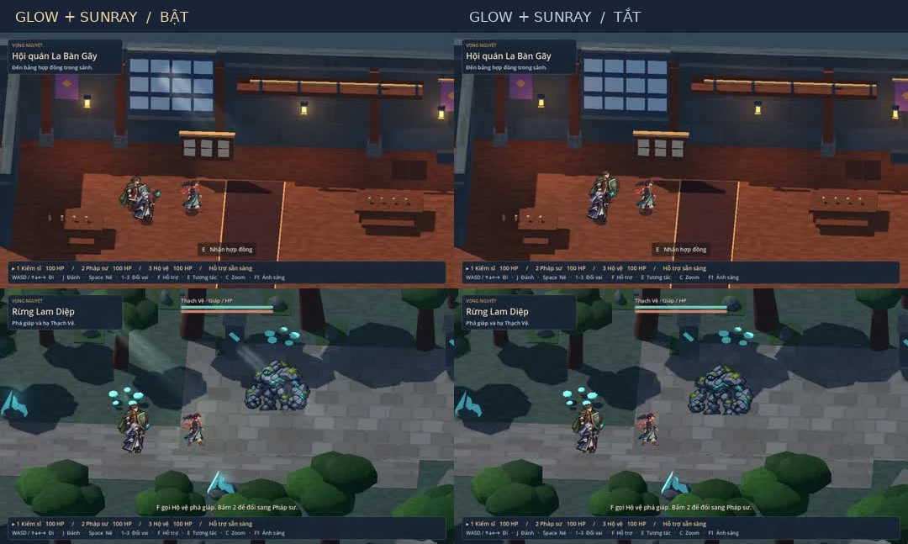

# Lát cắt Hội quán La Bàn Gãy → Rừng Lam Diệp

Mở `godot/project.godot` trong **Godot 4.3** và bấm **F5**. Lát cắt chạy bằng **Compatibility**. Bản Sông Nguyệt mở riêng bằng **F6** ở `godot/world/song_nguyet_3d.tscn`.



## Test nhanh

| Phần | Thao tác và kết quả cần kiểm tra |
| --- | --- |
| Ánh sáng hội quán | Bấm **B** tắt hoặc bật Glow và **R** tắt hoặc bật Sunray. Nhìn cửa kính và đèn trên vách. Quầng nằm quanh lõi đèn. Tia bắt đầu ở khe cửa, và song cửa vẫn đọc rõ. |
| Rig và lấy mẫu | Bấm **F1** mở bảng thông số của khu đang đứng. Thử tăng `threshold` để nguồn yếu mất quầng, kéo `intensity` và `falloff` chậm để xem biên quầng. Với tia, thử `ray_angle`, `width`, `length`, `drift_speed` và màu. Bấm **C** đổi zoom hai lần và đi ngang. Nhìn mép khăn, pháp trượng, khiên và tia VFX để phát hiện viền nhấp nháy hoặc bàn chân trượt. |
| Hợp đồng và cổng | Dùng **WASD** hoặc phím mũi tên đi tới bảng hợp đồng trước cửa kính. Bấm **E** hoặc nút tương tác để nhận hợp đồng. Đi qua lối ra ở phía phải sảnh và cổng Thành Vách Gió. |
| Giao tranh | Đến gần Thạch Vệ. Thanh ngọc lam là giáp và thanh cam là HP. Dùng **J** đánh và **Space** né vòng báo đòn. Bấm **F** khi quái ở gần để Hộ vệ tiếp cận và phá giáp. Bấm **2** sau nhịp ra đòn để đổi sang Pháp sư, rồi dùng **J** bắn phép. |
| Kho báu | Khi Thạch Vệ đã gục, rẽ xuống phía dưới bên phải sân để gặp rương. Bấm **E** cạnh rương để nhận La Bàn Lam Tinh. |

## Tệp chính

- [Cảnh khởi động và camera](../godot/fantasy/scenes/adventure_slice.tscn) nối ba cảnh 3D. [Guild](../godot/fantasy/scenes/guild.tscn), [Gate](../godot/fantasy/scenes/gate.tscn) và [Forest](../godot/fantasy/scenes/forest.tscn) có các mốc đặt trực tiếp trong scene. [Stage builder](../godot/fantasy/scenes/stage_builder.gd) dựng sàn, công trình, đạo cụ và va chạm khi vào game.
- [Light rig](../godot/fantasy/lighting/light_rig.gd) dùng quầng cộng sáng theo nguồn được đánh dấu. `threshold` lọc năng lượng của từng nguồn, và tia 3D có depth test cùng một đèn chiếu cục bộ để sáng lên trên bề mặt. Bảng F1 sửa thông số trong phiên chơi. Mặc định của hai khu nằm trong Inspector tại node `LightRig`.
- [AdventurerData](../godot/fantasy/combat/adventurer_data.gd) định nghĩa dữ liệu đọc từ các tệp `.tres`. [CombatActor](../godot/fantasy/combat/combat_actor.gd) đặt cửa sổ hitbox và né bằng method track trong `AnimationPlayer`. [PartyController](../godot/fantasy/combat/party_controller.gd) nhận lệnh đổi người, giữ HP riêng và quản lý hồi chiêu hỗ trợ.

## Kiểm tra kỹ thuật

```sh
godot --headless --editor --path godot --import --quit
godot --path godot --disable-render-loop --fixed-fps 60 --script res://fantasy/tests/smoke.gd
```

Lệnh thứ hai cần một môi trường có màn hình. Smoke test chạy input hợp đồng, cổng và các nút ánh sáng qua Godot, sau đó đặt các diễn viên trong khu đánh để kiểm tra từng tình huống combat có thể lặp lại. Một lượt thứ hai đi hết hợp đồng bằng input với AI của quái hoạt động, bao gồm kiểm tra đồng đội qua cửa hội quán. Bài test xác minh chống trúng lặp, từ chối đổi vai khi lấy đà, khung né, hồi chiêu hỗ trợ, phá giáp, đạn phép và khóa rương theo tiến độ.

Vòng review đầu phát hiện hai vách chồng lên khe cửa kính và tia rừng quá mờ. Bản A/B phía trên chụp sau khi mở đúng khe cửa, đổi vị trí tia và thêm ánh sáng lên sàn. Ảnh lấy từ Godot 4.3 Compatibility trên Linux với llvmpipe ở 1120 × 630. Đã xem hình ở hai mức zoom. Hiệu năng trên GPU và điện thoại thật vẫn cần đo.
